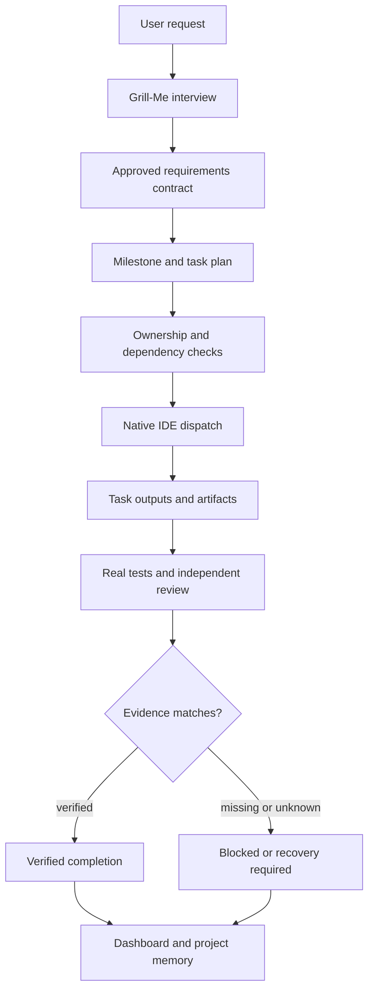

# Auto-Orchestrator

**Native multi-agent teamwork, verified completion and IDE continuity.**

[](https://github.com/eniskorkut/auto-orchestrator/actions/workflows/tests.yml)
[](LICENSE)

[English](README.md) · [Türkçe kılavuz](docs/README.tr.md) ·
[Getting started](docs/GETTING_STARTED.md) ·
[Architecture](docs/ARCHITECTURE.md) ·
[Security](docs/SECURITY.md) ·
[History](docs/HISTORY.md)


<p align="center"><em>Evidence console in demo mode. All data is synthetic and labelled <code>DEMO DATA</code>.</em></p>

## What it is

Auto-Orchestrator is a local coordination layer for IDE-native coding agents. It
gives **OpenCode V2, Codex, Cursor and Google Antigravity** one shared workflow
for requirements, planning, file ownership, native dispatch, verification and
continuity — without hosting a model, proxying provider traffic or launching
another IDE.

It is for developers doing multi-step work where a single chat loses track of
requirements, two agents write to the same file, or a confident summary is not
the same thing as a passing test. The native IDE remains the only entity that
spawns its own subagents. Auto-Orchestrator records the contract, gates the
state transitions and refuses to call unknown evidence "verified".

It is **not** just a collection of agent prompts. Skills and agents do the work;
the CLI adds durable plans, canonical write scopes, typed dispatch records,
run-bound test evidence, single-use HMAC receipts and a read-only dashboard.
When evidence is missing, the system says `unknown` instead of inventing success.

## Features

- **Native teamwork coordination.** Plans milestones and tasks, then leaves
  spawning to the IDE's own native subagent system.
- **Grill-Me requirement refinement.** A durable, one-question-at-a-time
  interview. Recommended options are never treated as answers; critical
  questions block implementation until resolved.
- **Milestone planning.** Scope contracts, dependencies, adaptive
  SOLO/FAST/BALANCED/RIGOROUS modes and explicit approval for native plans.
- **Dependency-aware dispatch.** One active dispatch per task, at most three
  active dispatches, verified dependencies and disjoint write scopes.
- **File ownership conflict prevention.** Canonical paths, symlink checks,
  owner tokens and fence compare-and-swap stop concurrent writers.
- **Verified Completion.** Runs the approved test command, parses JUnit XML or
  pytest JSON, rejects skipped/inconsistent evidence and binds the result to the
  commit, contract, plan, run and task.
- **IDE ownership and handoff.** One writer at a time, heartbeat liveness,
  digest-bound handoff snapshots and explicit accept/release steps.
- **Project memory and continuity.** Durable decisions, requirements,
  interviews, handoffs and Git observations survive an IDE change.
- **Evidence dashboard.** A read-only, loopback-only console for runs, native
  spans, checks, milestones, ownership and the Virtual Agent Office.
- **Conservative telemetry.** Opaque IDs, timestamps, platform and status only.
  No prompts, source code, commands, tool output, API keys or uploads.

## How it works



A dispatch is a recorded contract, not a remote-control API. The parent session
starts the native child, reports a child reference and collects the artifact.
`running` requires that reference; `completed_claimed` is not completion;
`verify` requires a matching verification record. Unknown lifecycle becomes
`recovery_required`, never `verified`.

The same workflow is exposed through files and a CLI, so a new IDE session can
read the state, resume the next step and continue without pretending to be the
previous process.

## Supported IDEs

| IDE | Entry points | Native teamwork | Grill-Me | Handoff | Live evidence |
|---|---|---|---|---|---|
| **OpenCode V2** | `/teamwork`, `/grill-me`, plugin, agents | Native plan + managed OpenCode execution | Command + skill | Live-verified | Foreground spans; background child completion unsupported |
| **Codex** | Skill, agents, CLI | Native plan and records | Skill + CLI | Live-verified (V7.8/V7.9) | Child lifecycle `not-tested`; hooks are conditional |
| **Cursor** | Agents, skill, agent CLI | Protocol ready | Skill | Simulated | `blocked-auth` on this machine; project hooks only |
| **Antigravity** | Native `/teamwork-preview`, `/grill-me` | Bridge only | Native command | Simulated | `contract-only`; no CLI adapter |

No IDE is launched by another IDE. The machine-readable limits are in the
[capability matrix](docs/CAPABILITY_MATRIX.md); do not treat a contract-only
adapter as a live native integration.

## Quick start

Requirements: **Python 3.11+**, Git and a supported IDE. Node.js is only needed
for this repository's plugin/browser tests. The runtime is standard-library
Python.

### OpenCode V2 — project-local (recommended for one repository)

```bash
git clone https://github.com/eniskorkut/auto-orchestrator.git
cd auto-orchestrator

python3.11 tools/install.py \
  --target /path/to/your/project \
  --platform opencode \
  --opencode-version v2 \
  --dry-run

python3.11 tools/install.py \
  --target /path/to/your/project \
  --platform opencode \
  --opencode-version v2
```

Review the dry run first. Restart OpenCode and open a new session, then verify
the installed runtime from the target project:

```bash
cd /path/to/your/project
python3.11 tools/universal_teamwork.py --root . --platform opencode --help
python3.11 tools/universal_teamwork.py --root . --platform opencode brief
python3.11 tools/universal_teamwork.py --root . --platform opencode native-dispatch status --run-id smoke
python3.11 tools/dashboard.py --help
```

The installer creates only managed files. It preserves existing provider
credentials, session history and unrelated settings; it refuses to overwrite
user-modified files and records its own files for uninstall. A new session is
normally required for command and skill discovery. See
[OpenCode V2 integration](docs/OPENCODE_V2.md) for the file map and plugin
semantics.

### Global install (optional, shared across projects)

Choose project-local **or** global for a workspace. Two live copies can emit
duplicate hooks and telemetry.

```bash
python3.11 tools/install_global.py \
  --platform opencode \
  --opencode-version v2 \
  --dry-run

python3.11 tools/install_global.py \
  --platform opencode \
  --opencode-version v2

python3.11 tools/doctor.py --platform opencode
```

`doctor` verifies installed files and basic structure. It does not prove that
the plugin loaded, that a model delegated work or that a test ran.

### Codex, Cursor and Antigravity

```bash
# Codex
python3.11 tools/install.py --target /path/to/project --platform codex

# Cursor (project-local hooks are required for observation)
python3.11 tools/install.py --target /path/to/project --platform cursor

# Antigravity
python3.11 tools/install.py --target /path/to/project --platform antigravity
```

Add `--dry-run` first. `--platform all` installs every adapter and defaults to
OpenCode V2; use `--opencode-version v1` only for OpenCode Classic. The V1 and
V2 plugins use different APIs and must not be loaded together.

### Uninstall

```bash
python3.11 tools/install.py --target /path/to/project --uninstall --dry-run
python3.11 tools/install.py --target /path/to/project --uninstall

# or, for a global install
python3.11 tools/install_global.py --uninstall --dry-run
python3.11 tools/install_global.py --uninstall
```

Only unchanged, manifest-owned files are removed. User-modified files and
project evidence are preserved.

## Real usage example

In an OpenCode V2 session:

```text
/grill-me Add a user login system with sessions.
```

Grill-Me asks one question at a time. Recommended options are shown first but
are **not** selected automatically. Answer in the chat; when the interview is
ready:

```text
/grill-me summary
/grill-me approve
```

Then start the approved work:

```text
/teamwork --mode balanced Implement the approved login flow
/teamwork status
/teamwork milestones
```

OpenCode uses its managed execution path by default. `--native` writes an
inspectable plan instead; the parent IDE starts the children and no provider,
runner or PID is created. Approval is explicit and digest-bound; there is no
auto-approval.

In Codex, Cursor or Antigravity, the native command/skill surface remains
authoritative; the same project state is available through the CLI:

```bash
python3.11 tools/universal_teamwork.py --root . --platform codex brief
python3.11 tools/universal_teamwork.py --root . --platform cursor ide status
```

The system does not claim that `/teamwork` automatically drives every IDE. Live
handoff is recorded for Codex and OpenCode; Cursor and Antigravity stay
contract-only until observed otherwise.


<p align="center"><em>Real CLI output from a disposable demo project; local paths shortened and demo answers used.</em></p>

## Dashboard

```bash
python3.11 tools/dashboard.py --root . --open   # real project evidence
python3.11 tools/dashboard.py --demo --open     # clearly labelled synthetic data
```

### Runs and verified completion


The Runs view separates completion, checks and verification. A green terminal
state is not a quality gate; a check is only counted when the native client
reported an integer exit code after the last observed edit.

### Teamwork milestones and ownership


Milestones count only verified progress. The ownership panel shows the active
IDE, fence, handoff age, drift and the next recommended action. Missing evidence
renders as `unknown`.

All three dashboard images come from the real application running with
`--demo`; the `DEMO DATA` badge is visible. They are not real user data or a
benchmark.

The dashboard is read-only: it cannot spawn, stop or message an agent, claim a
task, merge a worktree or replace the CLI. See [Dashboard](docs/DASHBOARD.md).

## Security and verification

- **HMAC receipt.** `native-verify` signs a canonical payload with a per-project
  key at `.auto-orchestrator/ide/verification.key` (mode `0600`). The receipt
  binds project, run, task, dispatch, commit, contract, plan, test evidence and
  artifact digest/size, and is **single-use**.
- **Commit/contract/plan binding.** A receipt for one dispatch cannot verify
  another dispatch, run or commit.
- **Run-bound test evidence.** The approved command is executed by the verifier,
  parsed from JUnit XML or pytest JSON, checked for skipped/inconsistent results
  and gated on a clean merged tree.
- **Ownership fencing.** Canonical write scopes, owner tokens and fence
  compare-and-swap prevent concurrent writers created by path aliases or symlink
  parents.
- **Trust boundary.** The receipt key protects against file-only forgery. A
  same-user process that can read the key can forge a receipt; this is an OS
  trust boundary, not a sandbox. Handoff and dispatch are coordination
  protocols, not OS isolation.
- **Privacy.** Telemetry stores opaque IDs, timings, platform and status. Prompts,
  source code, commands, tool output and credentials are not written. The
  dashboard binds to loopback and uploads nothing.

Read [Security and verification](docs/SECURITY.md) for the exact guarantees and
non-guarantees.

## Limitations

- **Native child lifecycle is not live-verified on every IDE.** Codex and
  OpenCode have live handoff evidence; their child lifecycle can still be
  `not-tested` or foreground-only. OpenCode background child completion is not
  authoritative.
- **The handoff and dispatch protocol is not an OS sandbox.** It coordinates
  cooperative agents; it does not contain a hostile same-user process.
- **Cursor authentication can block live tests.** On this machine the Cursor
  agent CLI is installed but requires authentication (`blocked-auth`); this can
  vary by environment.
- **The Antigravity adapter is not live-verified.** Native Antigravity commands
  remain authoritative; the bridge is contract-only.
- **Token and cost savings are not benchmarked.** Observed tool-span overlap is
  a scheduling indicator, not measured human time saved. Historical measurements
  in [HISTORY](docs/HISTORY.md) are context-specific.
- **OpenCode V1 and V2 plugins are not interchangeable.** Select the version
  matching the installed client; do not load both.
- **Managed execution is not universal.** OpenCode is live-verified; Codex
  managed write mode is an explicit opt-in; Cursor and Antigravity managed
  execution are not implemented.
- **A passing `doctor` is not runtime proof.** It checks files, not plugin
  loading, model choice or native spawning.

## Documentation

- [Getting started](docs/GETTING_STARTED.md)
- [OpenCode V2 integration](docs/OPENCODE_V2.md)
- [Architecture](docs/ARCHITECTURE.md)
- [Security and verification](docs/SECURITY.md)
- [Troubleshooting](docs/TROUBLESHOOTING.md)
- [Dashboard](docs/DASHBOARD.md)
- [Multi-project registry](docs/MULTIPROJECT.md)
- [Virtual Office and Agent Inspector](docs/VIRTUAL_OFFICE.md)
- [Native capability matrix](docs/CAPABILITY_MATRIX.md)
- [V8.0 native dispatch](docs/V80_NATIVE_DISPATCH.md)
- [V8.0 overview](docs/V80_NATIVE_INTELLIGENT_TEAMWORK.md)
- [Release history](docs/HISTORY.md)
- [Türkçe kılavuz](docs/README.tr.md)
- [IDE testing and readiness](IDE_TESTING.md)
- [Benchmark methodology](BENCHMARK.md)

## Tests

```bash
python3.11 -m unittest discover -s tests -v
npm run test:js
npm run test:browser
```

The Python suite covers installer/runtime completeness, ownership, dispatch,
receipts, verification and dashboard contracts. Node tests cover the OpenCode
V2 plugin event shapes. Playwright tests run against the real local dashboard.
Browser tests need the system Chrome channel; set `AO_BROWSER_CHANNEL=none` to
use Chromium if installed.

Hosted CI replays documented payloads and runs the local UI. It does **not**
authenticate to Codex, OpenCode, Cursor or Antigravity. A green CI run is not a
native IDE end-to-end result; live smoke tests are reported separately in
[IDE testing](IDE_TESTING.md).

## License and contributing

MIT — see [LICENSE](LICENSE).

Issues and pull requests are welcome. Keep changes focused, add a regression test
for installer or evidence changes, run the suites above, and do not claim a live
IDE result from a simulated test. Report security issues privately as described
in [SECURITY](docs/SECURITY.md).
