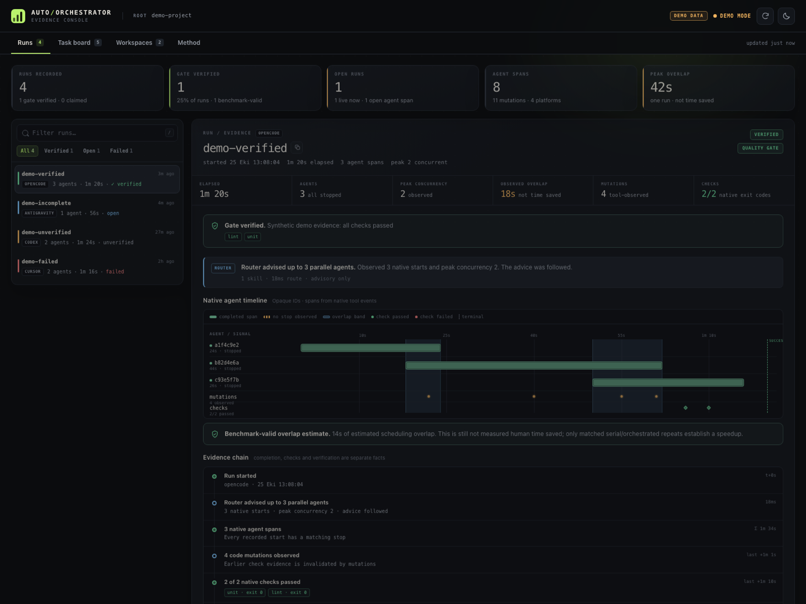
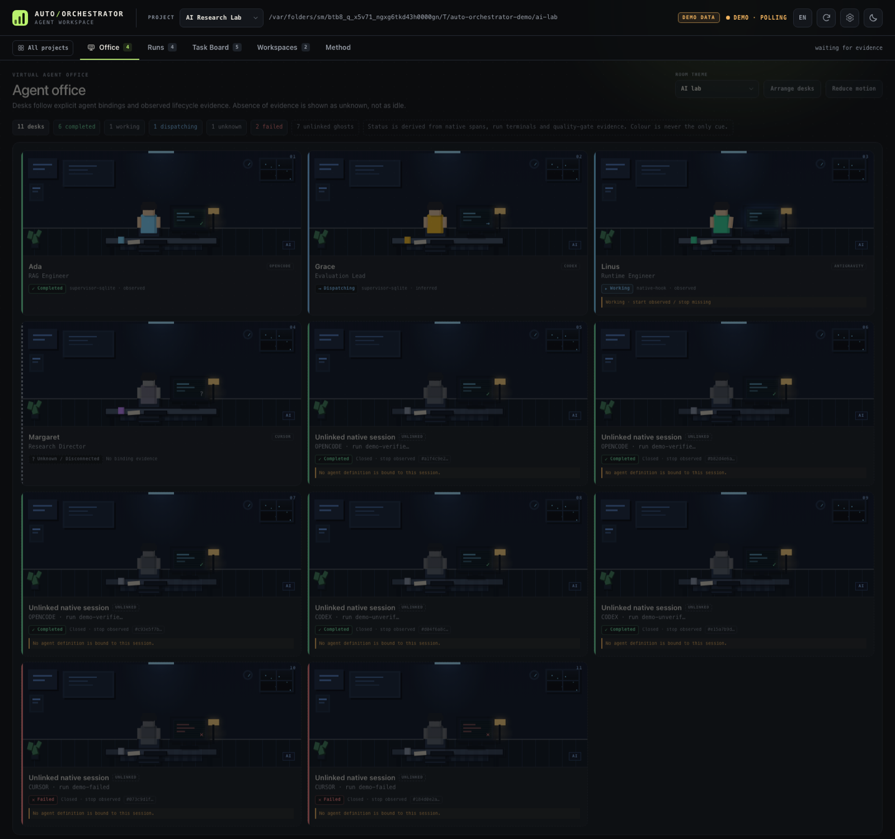
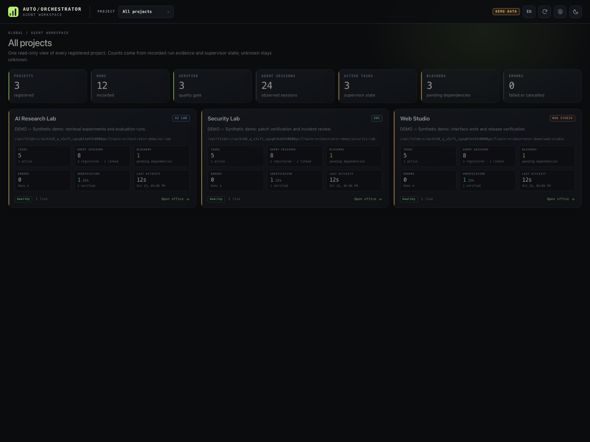

# Auto-Orchestrator — Native Multi-Agent Coordination (V7.4.1)

Portable, opt-in native-subagent coordination for **OpenCode**, **Codex**, **Cursor**, and **Google Antigravity**. Platform-native runtime capabilities and proof strength differ.

The project uses **one common skill and per-platform agent definitions**. It does not host its own LLM or promise to force models to delegate. It instructs native agents to delegate when beneficial, and provides an evidence-based time-reporting CLI.

## What V1 does

- Installs one `.agents/skills/auto-orchestrator/SKILL.md` across all three supported clients.
- Adds a short, idempotent activation rule to the **target project's** `AGENTS.md`.
- Provides explorer, implementer, tester and reviewer agent profiles.
- Uses the calling model by default. Optional **Codex** mode sets `gpt-6-luna` with `max` effort for subagents only (subject to client/model availability).
- Supports concurrency up to **3** independent native agents, guarded by dependency and file ownership rules.
- Records real wall times and agent overlaps with a zero-dependency local CLI. Reports *estimated parallelism benefit*, NOT measured human time saved.

## Installation

Python **3.11+** is required for installer and reporting CLI; agent skills themselves are Markdown.

```bash
python tools/install.py --target /path/to/your/project --platform all --codex-model inherit
# Optional, Codex only:
python tools/install.py --target /path/to/your/project --platform all --codex-model luna-max
# Preview without writing:
python tools/install.py --target /path/to/your/project --platform all --dry-run
```

Windows PowerShell:

```powershell
py -3 tools/install.py --target C:\\work\\my-project --platform all --codex-model luna-max
```

`--platform` supports `all`, `codex`, `opencode`, `antigravity`. Installer **never replaces unrelated user files**: it creates files, recognizes unchanged files, or refuses conflicts. For its own marked `AGENTS.md` section it updates only that section. Existing `.codex/config.toml` content is preserved; the installer refuses an incompatible existing `[agents]` config and explains manual editing. Use `--force-generated` to explicitly replace generated agent profiles (creates `.bak` backups). Installation is project-local. For other repositories, run it again with a different `--target`.

New chats/sessions may be necessary for configuration to be discovered. The skill is discovered automatically but a given model may still decline delegation; no hook-based hard enforcement is claimed.

## Automatic activation and telemetry (V2)

Installer now includes the following project-local instrumentation by default:

| Client | Activation/telemetry | Limit |
|---|---|---|
| Codex | `.codex/hooks.json` + `tools/hook_bridge.py` (`UserPromptSubmit`, `SubagentStart`, `SubagentStop`, `Stop`) | Trust the project and hooks with `/hooks` before they run. |
| OpenCode classic | `.opencode/plugins/auto_orchestrator.js` (system instructions, session + native `task` tool lifecycle) | OpenCode V2 is supported by the separate native `setup(ctx)` adapter (`adapters/opencode-v2/`); V1 and V2 require different plugin APIs. |
| Antigravity | `.agents/hooks.json` + hook bridge (`SessionStart`, `PreInvocation`, `Stop`) | Measures main execution only; native subagent run-time events not established. |

The hooks are advisory and do not bypass user approval, client permissions, or native capabilities. Some client installs only discover new hooks after restart. Auto-activation is best-effort, not guaranteed spawning. Hook tool commands assume `python` is available and run from the project root; adjust the command on installations with only `python3`.

## Reporting

Hook-aware mode begins/ends runs automatically where supported. After successful validation, **before the final answer**:

```bash
python tools/perf.py verified --latest
python tools/perf.py report --latest
```

Manual fallback (no enabled hooks/plugin):

```bash
python tools/perf.py start --run-id demo --platform codex
python tools/perf.py agent-start --run-id demo --agent-id explorer
python tools/perf.py agent-stop --run-id demo --agent-id explorer
python tools/perf.py agent-start --run-id demo --agent-id tester
python tools/perf.py agent-stop --run-id demo --agent-id tester
python tools/perf.py verified --run-id demo
python tools/perf.py finish --run-id demo --status success
python tools/perf.py report --run-id demo
```

By default the run log is placed inside the target repository under `.auto-orchestrator/runs`, which the installer adds to `.gitignore` if necessary. To avoid recording any prompts, source code, API keys or user secrets, event files contain **only timestamps, opaque IDs, platform, status and verification**. No telemetry is uploaded. Optional `--root /path/to/project` picks the target project. `--time` exists **for deterministic testing and importing externally measured timestamps**; routine tasks should omit it.

When 2+ subagent durations are complete, the task is verified, and the calculated advantage is positive, `report` prints:

> Estimated parallelism benefit: 12m (not independently benchmarked human time saved)

Formula: `sum(agent wall times) - elapsed run wall time` (conservative approximation; may be negative). In case of insufficient evidence it prints **Not available**. This is a scheduling overlap indicator, **not** an experimental single-agent speedup measurement. Baseline benchmarking is a later milestone.

## Evidence dashboard

Inspect the same local evidence in a browser. The dashboard is a read-only viewer that binds to loopback on port 8765 by default and never starts, stops or mutates an agent.



```bash
python tools/dashboard.py --root . --open
# Clearly labelled synthetic data; writes nothing and is not a benchmark:
python tools/dashboard.py --demo --open
```

- **Shows:** run timelines with completed and open native spans, observed overlap bands, evidence chains, native check results, Supervisor task state and managed worktree manifests.
- **Can establish:** whether a recorded quality-gate claim still matches the current verification policy, and which native starts, stops and checks the evidence records as observed.
- **Does not establish:** full task correctness, that an open span is still running, or that observed overlap equals human time saved. Only matched serial/orchestrated repeats establish a speedup.
- **Does not control:** it cannot spawn or stop agents, claim or complete tasks, merge or clean worktrees, or replace `perf.py`, the Supervisor or `benchmark.py`.
- **No invented cost:** the current evidence schema has no token or price fields, so the console shows no cost figures.

See [docs/DASHBOARD.md](docs/DASHBOARD.md) for screens, verification semantics, the privacy model and troubleshooting.

## Caveats and roadmap

- **Antigravity** native custom subagents are documented for **2.0/CLI**; IDE skill discovery is supported, but native subagent parity needs verification on installed IDE versions.
- **OpenCode** agent definitions follow the current classic Markdown agent config. OpenCode V1 and V2 have different plugin APIs; select `--opencode-version` matching the installed client.
- **Codex** subagent model override is best-effort configuration; model ID and access should be checked on an actual run.
- **V2** adds Codex/Antigravity lifecycle hook adapters and OpenCode classic plugin capture, but has no background daemon, standalone DAG runner, automatic Git worktree operations, or cross-platform guaranteed active-model telemetry. Native-client end-to-end tests have **not** been run.

## Sources

- Codex: https://developers.openai.com/codex/subagents
- OpenCode: https://opencode.ai/docs/agents and https://docs.opencode.ai/docs/skills/
- Antigravity: https://www.antigravity.google/docs/skills and https://antigravity.google/docs/subagents

## Tests

```bash
python -m unittest discover -s tests -v
node --test tests/js/test_opencode.mjs
```

Integration tests replay real documented hook input shapes using subprocesses and simulate OpenCode events in Node. They do not authenticate to or launch Codex, OpenCode, or Antigravity clients.

Licensed under MIT (see LICENSE).

## V3 — global installation and IDE testing

V3 adds a global, reversible setup for **Codex, OpenCode Classic/V2, and Antigravity IDE/CLI**; it supplements the project-local V2 installer.

```bash
python tools/install_global.py --platform all --opencode-version v2 --codex-model inherit --dry-run
python tools/install_global.py --platform all --opencode-version v2 --codex-model inherit
python tools/doctor.py --platform all
# Remove only managed, unchanged assets (preserves user-edited files):
python tools/install_global.py --uninstall
```

For Codex Luna Max, pass `--codex-model luna-max`. If your existing `~/.codex/config.toml` requires edits, the global installer **fails safely** and provides instructions rather than rewriting it. Global OpenCode V2 uses a native `setup(ctx)` plugin with event subscriptions; V1 uses its legacy plugin. User files are not overwritten. See [IDE_TESTING.md](IDE_TESTING.md) for three independent manual smoke scenarios.

**Limits:** global installation creates Codex/Antigravity hook files only when they do not already exist; existing hook files are extended with only the Auto-Orchestrator hook groups/namespace; existing user hook entries are preserved and injected entries are removed on uninstall. Conflicting or invalid hook configurations stop installation safely. OpenCode V2 plugin loading requires an IDE restart. Native telemetry remains unverified until observed in the running client. The `doctor` command checks file readiness, **not** real model choice, native subagent spawning or human time savings. Hosted CI tests mocked lifecycle contracts; actual IDE integration still needs manual smoke testing.

**Project-local OpenCode version:** `python tools/install.py --target /your/project --platform opencode --opencode-version v2` (default). For Classic use `--opencode-version v1`; a previously installed plugin requires `--force-generated` to switch safely with backup.


## V4 — Native task supervisor, skill router, safe parallel integration

V4 introduces **three standalone Python 3.11+ helpers** (stdlib only) available from both project and global installations:

| Tool | Purpose | Important limit |
|---|---|---|
| `tools/supervisor.py` | Durable SQLite task IDs, dependency-aware claiming, max 3 active native agents, attempt-specific leases, timeout/cancel acknowledgement, max 2 retries, structured results | Does not spawn or terminate IDE agents |
| `tools/router.py` | Discover installed `SKILL.md` metadata and produce minimal per-task context with up to 2 relevant skills | Does not ingest private conversations or execute skill text |
| `tools/worktree.py` | Create isolated Git worktrees, preview merge conflicts without changing the main tree, safely clean worktrees | Does not automatically merge or delete branches |

### Minimal demonstration (project-local installation)

Run these commands in your **target project**, after installing Auto-Orchestrator:

```bash
python tools/supervisor.py init --run-id example-001 --plan examples/v4-plan.json
python tools/supervisor.py claim --run-id example-001
python tools/router.py --root . brief --plan examples/v4-plan.json --task-id docs
# Spawn the claimed task(s) through your IDE's native subagent tool.
# On confirmed native completion with successful checks:
python tools/supervisor.py completed --run-id example-001 --task-id docs --lease LEASE --result examples/v4-result.json
python tools/supervisor.py status --run-id example-001
```

The sample files are included in **this repository**. For another target project, use your own scoped JSON plan and result; copy sample files only as a starting template. The leased task must be executed by the native IDE tool; the helper never fakes its execution.

Isolated worktree operations (in a clean Git project):

```bash
python tools/worktree.py --repo . create --task-id backend
# Make and commit changes in the returned worktree path.
python tools/worktree.py --repo . preview --task-id backend
```

A clean preview is only a conflict preflight, **not a verified/tested merge**. Main agent still reviews changes, runs tests, and decides integration. If native cancellation or completion cannot be observed, the Supervisor keeps contested scope reserved.

Read [the V4 protocol](.agents/skills/auto-orchestrator/references/supervision.md) and [IDE test guide](IDE_TESTING.md). GitHub Actions runs deterministic unit and mock integration tests; **it does not constitute authenticated real IDE end-to-end evidence**.

## Benchmark and OpenCode V2 telemetry

Read [BENCHMARK.md](BENCHMARK.md) to collect matched serial/orchestrated runs. Project installations now include `tools/benchmark.py`; global installation places it under the platform's `auto-orchestrator/tools` directory.

For **global OpenCode V2**, run `python <global-opencode-config>/auto-orchestrator/tools/perf.py --root <your-project> report --latest --json` (replace placeholders with actual paths). The plugin writes local run events in the project. Restart OpenCode after installing to load the V2 plugin, then confirm that new `.auto-orchestrator/runs/*.jsonl` files appear. A passing `doctor` or mock plugin test alone does not prove runtime telemetry is active.

Paths protected by the installers are checked for symlink traversal; concurrent external filesystem mutation is outside this local installer guarantee. Credentials used for Supervisor attempt leases are local control values, not a cross-user authorization mechanism.


## Codex / Antigravity native-hook compatibility

Codex user hooks reside at `~/.codex/hooks.json` and Antigravity user hooks at `~/.gemini/config/hooks.json`. When these files already exist, the global installer merges **only** our native hook entries with the existing JSON, preserves user groups, and remembers the injected entries for safe uninstall. Dry runs make no changes. Conflicting Antigravity `auto-orchestrator` namespace entries or malformed hook files cause a safe installation error instead of an overwrite. After setup, review/trust newly configured hooks inside the native client; restarting the IDE and passing `doctor` do not prove runtime execution.

The hook bridge now uses Codex's `cwd` or Antigravity's single active `workspacePaths` path when provided so event logs are saved under the active project; otherwise it falls back to the hook process working directory. For multiple Antigravity workspaces, it intentionally does not guess an active project.

**Important:** Codex `SubagentStart`/`SubagentStop` can supply native subagent durations; Antigravity's hook-based telemetry still tracks sessions, **not** confirmed subagent wall time. Do not derive subagent time savings from Antigravity session hooks. Review [IDE_TESTING.md](IDE_TESTING.md) and platform diagnostics before claiming live E2E success.


## OpenCode V2 native event telemetry and workspace isolation

The OpenCode V2 plugin observes the native `subagent` tool rather than the OpenCode V1 `task` tool. It matches hook calls by native event `id`, handles `event.data.sessionID`, and writes `finish` only after `session.execution.succeeded`, `session.execution.failed`, or `session.execution.interrupted`.

**Workspace privacy:** Global plugin instances may see events from other project locations. Only an event with an **explicit matching location** can open a new local run; later callbacks without a location can update a run already associated with that location. Cross-project events are ignored. Event logs still contain only hashed agent IDs, timings, platform and status—no prompts or model-provided content. On global installations a new project's `.auto-orchestrator/runs/` directory is not automatically added to that project's `.gitignore`; add `.auto-orchestrator/` to project Git ignore rules or `.git/info/exclude` before running monitored sessions if you do not want those local logs listed by Git.

**Background subagents:** When a background `subagent` call returns immediately, its tool span is only the spawn-call duration, **not** the background child execution time. Do not interpret it as an authoritative full child runtime or human time saved. Unverified runs cannot claim benchmark savings. Runtime support and active plugin loading must be verified within OpenCode Desktop; hosted CI simulates hook/event shapes and cannot replace live tests.


## V5 — OpenCode opt-in automatic verification (evidence-based)

V5 separates **execution completion** from **verification**. OpenCode V2 native hooks can record minimal check and mutation events. Finish always records the actual outcome. Only after successful execution may the plugin append a separate verified event, provided every configured check was observed with native integer exit code 0 after the last native agent completion or observed code edit.

Auto-verification is **disabled by default**. To enable it, copy [examples/v5-verification.json](examples/v5-verification.json) to the project's .auto-orchestrator/verification.json and edit its required_checks. This requires version 1, auto_verify true, and one or more checks with exact bash/shell tool and command strings. The plugin **never executes these commands itself**; it only observes already-executed commands with native exit-code metadata, recording check IDs and exit codes, not command text, tool output, or prompts.

For a finished run, report with:

~~~bash
python tools/perf.py --root /path/to/project report --latest --json
~~~

Use --run-id instead of --latest for concurrent sessions. If a successful run has recorded trustworthy check evidence but no verified event, run: python tools/perf.py --root /path/to/project verified --run-id ID. This independently checks the policy and evidence before allowing post-finish verification. Legacy V4 JSONL logs remain readable.

**Limitations:** Native tool status without integer exit code is not verification. Configured test success does not prove full task correctness. Unknown edits and background child modifications can invalidate evidence; review diffs where warranted. Global installs do not automatically update individual projects' Git ignore settings. Ignore .auto-orchestrator/ if desired. Estimated overlap is not benchmarked serial speedup.


## V6 — Opt-in Supervisor native evidence and Cursor support

V6 adds a **real correlation mechanism** between Supervisor's SQLite attempts and observed native subagent events. It is not an independent LLM process launcher. The native IDE remains the only entity authorized to spawn or cancel its own agents; the Supervisor handles plan dependencies, write scopes, active leases and retries. Native lifecycle observations now strengthen evidence instead of silently completing tasks.

Create a scoped plan with `"native_supervision": true` (see `examples/v6-native-plan.json`). Use `python tools/supervisor.py --root PROJECT init --run-id RUN --plan PLAN.json`, then `claim --run-id RUN`. Dispatch each claimed task through a native IDE subagent. **After obtaining the actual native agent ID**, bind the attempt:

~~~sh
python tools/supervisor.py --root PROJECT bind-native --run-id RUN --task-id backend --lease REAL_LEASE --platform codex --native-id REAL_NATIVE_AGENT_ID
~~~

With a compatible trusted **Codex** `SubagentStop` hook, the matching native stop is observed and stored as a SHA-256-derived ID. For Cursor, the documented `subagentStart` hook includes `subagent_id` but `subagentStop` currently does **not guarantee an ID**. No task-completion or lease-release claim is made without an exact stop identity. Antigravity's documented `PostToolUse` is a tool-dispatch event, **not** an authoritative subagent-stop event. OpenCode V2 background spawn callbacks are also not trustworthy child termination proofs. For these unsupported/ambiguous cases, the scope stays locked until valid native completion evidence is available; do not use fabricated CLI events.

Once the native stop is observed, the main agent must still validate actual changes and tests and explicitly call `completed --run-id RUN --task-id TASK --lease REAL_LEASE --result RESULT.json`. Failed/timeout/cancelled tasks do not free write scopes merely due to expiration; retry budget and native cancellation acknowledgement stay in force. A run with no native supervision opt-in retains existing V4 semantics. This is a trust and correctness control, not a cryptographic security boundary against processes with the same OS user's SQLite write permissions.

**Cursor:** Use project-local `python tools/install.py --target PROJECT --platform cursor --dry-run`, then install if the files do not conflict. This creates `.cursor/hooks.json` and `.cursor/agents/*.md` with native Cursor hook schemas and model inheritance. Global `python tools/install_global.py --platform cursor` safely installs skills/agents **without global hooks**, because Cursor user-level hooks execute in `~/.cursor` and their documented payload does not attest a project directory. For runtime instrumentation, opt into project-local hooks in the actual workspace. Existing Cursor hook config is never overwritten silently.

**Cross-platform status:** OpenCode V2 has prior Windows Desktop field testing for delegation and Quality Gate; the new V6 native ownership/stop integrations remain untested on installed IDEs. Codex, Cursor and Antigravity hook event contracts are covered by deterministic simulated tests only. Cursor subagentStop and Antigravity tool dispatch must not be advertised as proven per-agent durations. `doctor` verifies files, not runtime hooks. A serial-vs-parallel real-work benchmark remains deferred.

See [V6 supervision notes](docs/V6_NATIVE_SUPERVISION.md) for the native evidence contract, fallbacks and remaining gaps. 


## V6 — Native Supervisor integrity and platform verification

Native supervision is opt-in through `native_supervision: true` in a task plan. The SQLite Supervisor manages claims, scoped concurrency, leases, dependencies and retry/cancel states. It **does not launch IDE agents**. A native agent's observed start and matching stop are required before a bound task's structured completion can release dependencies. This rule also holds when the start callback precedes `bind-native`: short-lived native hook start evidence is buffered and matched against the existing claim. A stop-only callback never authorizes completion.

Cursor project installations now register both `subagentStart` and `subagentStop`, but native Cursor stop payloads may omit the child ID and some versions do not emit background stops. Those tasks must remain blocked, not be guessed complete. Antigravity currently cannot prove per-child stop via its documented session/invocation hooks. OpenCode V2 background dispatch completion is not child completion. See [Native Supervisor platform matrix](docs/NATIVE_SUPERVISOR_PLATFORM_MATRIX.md) for platform contracts, gaps, and disposable-workspace smoke procedures. CI exercises simulated hooks and state transitions; a passing job is not a substitute for a native IDE run.


### V6.1 OpenCode 2.1.x live compatibility

- **Quality Gate:** OpenCode V2 `shell` callbacks may send only `input.command`, with no `cwd` / `workdir` and no top-level status. An exact opt-in check can now be verified only when `ctx.session.get` authoritatively places the parent in this plugin's project and the native `execute.after` result carries an integer exit code with no explicit error. Any **explicit** mismatched cwd, moved/unavailable session, failed result, or missing exit code still blocks verification. An event-supplied location alone cannot authorize implicit cwd.
- **Supervisor bridge (global OpenCode install):** With an existing project `.auto-orchestrator/supervisor.sqlite3`, the V2 plugin forwards matching foreground `subagent` tool-call start/stop events to the installed `supervisor.py` using platform-scoped SHA-256 hashes, not raw IDs. Set `AUTO_ORCHESTRATOR_PYTHON` only when `python3` is not the appropriate Python runtime. If the bridge is unavailable, Supervisor **does not** infer completion.
- **Late binding:** After a claimed native-supervised task has run, inspect the corresponding `agent-start.native_hash` in the project's run JSONL. Bind the attempt using `python tools/supervisor.py --root PROJECT bind-native --run-id RUN --task-id TASK --lease LEASE --platform opencode --native-hash HASH`. Binding may follow the matching stop; buffered start+stop evidence is accepted only when it postdates the attempt claim and falls within the short observation window. The hash is of the OpenCode native **tool-call ID**, not a separate background child session ID. No task auto-assignment is attempted when multiple claims exist; the operator must correlate the correct call to its task.
- **Important limits:** A background dispatch still has no authoritative child stop. The server plugin has no proven OpenCode V2 Desktop toast API: rely on `perf.py` / JSONL rather than expecting a toast. CI validates contract simulations, not a restarted Desktop installation or actual autonomous delegation.


## V6 — IDE performance visibility (OpenCode V2)

The OpenCode V2 plugin can show a **brief IDE toast** after the project's opt-in Quality Gate has actually persisted a successful `finish → verified`. A completed run with two or more overlapping native tool spans may show **observed tool-span overlap**; this is **not experimentally measured time saved**. Background subagent dispatch is not a confirmed child stop and cannot authorize a verified run. A Desktop build without a compatible TUI API silently retains local JSONL and CLI reporting instead of interrupting agent work.

For a persistent result, use the installed `tools/perf.py --root <project-path> report --latest --json` CLI in the IDE terminal and inspect `observed_overlap_seconds`, `estimated_parallelism_seconds`, `has_valid_estimate` and `verified`. The separate `observed_overlap_seconds` value uses measured tool-span union, **not a matched single-agent benchmark**. Read [IDE Performance Visibility](docs/IDE_PERFORMANCE_VISIBILITY.md) for exact requirements, Windows example, and limitations. Future matched baseline benchmarks remain postponed.

## V6.2 — conservative skill routing and opt-in task review

V6.2 reduces false-positive Router selections using objective-derived task domains and minimum relevance evidence. A backend API task no longer gets a UI/animation skill solely from generic overlapping terms. `router.py brief` may legitimately return no skills. The classifier is deterministic and does not spawn native subagents or load full skill contents.

Plans may set `"require_review": true` (off by default). This adds a pre-completion structured review artifact, bound to the current task attempt and an exact digest of the submitted result. It rejects missing/failed/skipped tests or unresolved blocker/high findings. Existing native termination, lease and write-scope protections remain unchanged. Caller-created review records are **not** authenticated evidence of independent agent review or actual test execution.

Read [V6.2 routing and review](docs/V62_ROUTING_REVIEW.md) for examples and limitations. Hosted tests cover deterministic contracts; real IDE selection quality and reviewer independence require separate live evidence.

## V6.3 — OpenCode prompt-time Router

The OpenCode V2 global plugin now tries to select relevant skills **automatically at native prompt admission**, without asking the user to invoke `router.py`. It reads the native skill catalog and executes the installed local Python Router via stdin, never writing raw prompt text into telemetry. Explicit user-pinned skills are left intact, unknown prompts may select no skills, and unverified sessions fail closed. Router also gives conservative **advisory** one-agent vs possible-parallel guidance. This does not compel native subagent dispatch or prove time saved.

See [V6.3 native routing](docs/V63_NATIVE_PROMPT_ROUTING.md) for implementation, safety limits and real-IDE validation.

## V6.4 — Native lifecycle stabilization and measurable routing

OpenCode V2 now retries an unexpectedly closed native event stream, retaining
incomplete execution records instead of inventing a finished or verified run.
Use `python tools/perf.py --root PROJECT audit --json` to categorize missing
finish evidence. `perf.py report --latest --json` now separately shows
routing advice, observed native subagent starts/concurrency and prompt-routing
latency. Comparison reports treat unfinished attempts as incomplete rather
than dropping them from apparent speedup calculations.

Quality Gate permits only explicitly declared literal `alternates` for
allowed test commands; there is no fuzzy shell command normalization. Router
adds a small, conservative long-tail domain ontology and
`tools/router_eval.py` reports split-level accuracy, coverage and unrelated
skill selection rates. None of this proves live IDE reliability or speedup
until matched native runs are repeated. See
[execution reliability](docs/V64_RELIABILITY.md).

## V7.4.1 — Recovery, ownership and secure chat input

V7.4.1 hardens the V7.4 teamwork engine for interrupted, long-running work.

- **Crash recovery full pass:** a real two-implementer OpenCode run was killed
  while both children were alive; the bridge resumed, verified owned orphans,
  preserved worktrees, repaired once and finished with 13 backend tests plus
  browser E2E. Evidence: [recovery E2E](docs/assets/v741-recovery-e2e.json).
- **Owned process identity:** PID + start token + UID/time, atomic project
  locks, atomic active state, heartbeat and fail-closed stale-owner handling.
- **Recovery states:** `active`, `runner_disconnected`, `reconciling`,
  `orphaned`, `retry_ready`, `resuming`, `verifying`, `recovered`,
  `recovery_failed`; no native cancel ACK is claimed.
- **Secure single-chat input:** `/teamwork` writes the untrusted request to a
  validated UTF-8 file and passes `--request-file`; it never interpolates user
  text into a shell command. A real injection-shaped request preserved its
  text, created no marker and was cancelled locally.
- **Adaptive safety:** explicit FAST is upgraded for security, migration and
  breaking-API work; repository test commands are detected from manifests;
  handoffs include next tasks.
- **Honest efficiency:** on a tiny health-endpoint task serial was faster and
  cheaper than FAST; no speed-saving claim is made.

See [V7.4.1 reliability and security evidence](docs/V741_RELIABILITY.md).

## V7.4 — Adaptive teamwork and true parallel execution

V7.4 keeps the V7.3 managed-session/milestone runtime and fixes the coordination
layer: an event-driven bounded scheduler, FAST/BALANCED/RIGOROUS adaptive
planning, a single-chat `/teamwork` bridge, correct concurrency metrics and
restart orphan reconciliation.

- **True concurrency:** live two-session OpenCode probe: 8.65 s wall, 8.41 s
  true overlap, peak 2; the scheduler never blocks one task while waiting for
  another.
- **Adaptive modes:** FAST (one milestone, targeted verification), BALANCED
  (build/verify/risk review), RIGOROUS (full independent audit), and `auto`
  using a bounded repository profile. Missing repo facts fall back to BALANCED.
- **Single chat:** `.opencode/commands/teamwork.md` plus
  `tools/teamwork_chat.py` start/status/agents/milestones/cancel/resume without
  a separate terminal workflow. Child sessions stay separate managed sessions.
- **Correct metrics:** interval union is no longer called overlap; schema 2
  exposes true concurrent overlap, max/average concurrency and critical path.
- **Recovery:** orphaned running tasks are explicitly reconciled; local cancel
  is never shown as native ACK.
- **Real FAST E2E:** 33 backend tests and browser E2E passed; 247.8 s and
  $0.0528 versus V7.3’s 1566.1 s/$0.1404 on the same sample, with intentionally
  lower verification depth.

See [Adaptive teamwork and measured evidence](docs/V74_ADAPTIVE_TEAMWORK.md).

## V7.3 — Teamwork engine, managed execution and milestones

V7.3 adds a real managed-session runtime on top of the V7.1 Supervisor and V7.2
office. A single request is planned into milestones and a task DAG; implementers
work in isolated worktrees through **real OpenCode sessions**; testers, critics,
challengers, auditors and a success auditor verify the integrated result. A
bounded repair loop reopens the relevant implementer when verification fails.

- **Milestone state machine:** `planned → ready → running → verifying → passed`
  plus `repairing`, `failed`, `blocked`, `cancelled`; restart is recovered from
  the Supervisor SQLite database. Progress counts only verified passed
  milestones and never shows an estimate as success.
- **Managed execution:** OpenCode is live-verified via `opencode run --format
  json`; Codex App-server is contract-tested only; Antigravity and Cursor
  managed execution is not implemented. Native hook observation is unchanged
  and managed completion is never claimed as a native stop.
- **Real E2E:** a disposable task-manager project with backend, frontend, unit
  tests and browser E2E was built by managed sessions, independently reviewed
  and passed. A controlled frontend fault was detected, repaired and rerun.
- **Virtual Office:** real managed sessions spawn as named task characters in
  Backend/Frontend/QA/Review/Research rooms. Their inspector shows task,
  provider, model, status, tool count, cost and a session hash; it explicitly
  does not claim native stop proof or a terminal.
- **Dashboard:** Task Board has a Milestones panel with role requirements,
  handoffs, blockers and verified-only progress; clicking a milestone filters
  the board. Office header shows the current milestone.
- **CI:** Windows/macOS/Linux Python matrix, Node matrix, Playwright functional
  E2E and dependency/compile checks. Windows path normalization and home
  fallback regressions are fixed.

See [Teamwork engine and real E2E evidence](docs/V73_TEAMWORK.md).

## V7.2 — Virtual Office 2.0

V7.2 replaces the V7.1 workstation-card grid with **one continuous Canvas 2D pixel-art office per project**. Rooms, corridors, doors, furniture and a central spawn lobby share a single map; agents spawn only for observed native/managed sessions, walk through doors with A* pathfinding, sit at desks and change rooms when their task department changes. No card grid is rendered.



- **Evidence before animation.** Registry agents without a binding stay in the roster and are never drawn as working. Unlinked native sessions are labelled ghosts. Demo sessions are synthetic and labelled `DEMO DATA`.
- **Deterministic rooms.** `task.department`/`assigned_room` → agent `default_room` → `tester/reviewer/explorer` role mapping → Spawn/Lobby. Names and objectives never choose a room.
- **Separate visual and execution state.** Spawning, walking and sitting are animation events; a dropped SSE connection cannot produce a completion, and stale native spans stay `unknown`.
- **Per-project layouts.** Four complete floor plans (`ai`, `security`, `web`, `custom`) plus a versioned local override (`ao-office-layout:<project_id>`). Project changes destroy the old scene and never mix agents or positions.
- **Agent Inspector** keeps the evidence model: identity, task, activity, files/worktree, quality gate, native stop, terminal support. The terminal remains explicitly unsupported and never renders fake output.
- **Layout editor** for room, door and desk positions with grid snapping, validation, save and reset. It does not mutate evidence.
- **Responsive and accessible.** Room filters, hover tooltip, keyboard roster, zoom/pan, mobile layout, reduced motion and a focus-trapped inspector.
- **Browser coverage.** Playwright E2E and visual baselines at 1440×900, 1280×800, 768×1024 and 390×844 with the system Chrome channel; unit tests remain dependency-free Python and Node.

## V7.1 — Multi-project evidence console and Virtual Office

V7.1 adds a local project registry, a fleet overview and a project-scoped evidence console without weakening the read-only boundary. Every project keeps its evidence under its own `.auto-orchestrator/`; identical `run_id` values in two projects stay separate. The dashboard remains loopback-only and never starts, stops or messages an agent.



```bash
# Register/serve a project (auto-registers unless --no-register)
python tools/dashboard.py --root /path/to/project --open
python tools/project_registry.py add --root /path/to/project --name "Research Lab" --theme ai
python tools/project_registry.py list

# Conservative, evidence-based native capability matrix
python tools/capabilities.py show
python tools/capabilities.py show --platform cursor --json
```

The V7.1 **Virtual Office** introduced the project-scoped office, evidence-derived desk status and the Agent Inspector. V7.2 supersedes the desk grid with the continuous map described above; the evidence semantics and inspector remain.

- [Multi-project registry, isolation, migration and HTTP/SSE API](docs/MULTIPROJECT.md)
- [Virtual Office, Agent Inspector, themes, i18n and accessibility](docs/VIRTUAL_OFFICE.md)
- [Native capability matrix and simulated-vs-real test limits](docs/CAPABILITY_MATRIX.md)
- [Controlled planner/executor with acceptance evidence](docs/CONTROLLED_EXECUTION.md)

A deterministic planner/executor layer adds acceptance criteria to the existing
Supervisor DAG, rejects unordered write-scope overlap, emits a dispatch manifest
for the native IDE and refuses completion until every criterion has passed
evidence. It never spawns a native agent or merges a worktree.

```bash
python tools/project_planner.py validate --plan examples/v71-plan.json
python tools/project_planner.py init --plan examples/v71-plan.json
python tools/executor.py next --run-id checkout-retry --json
```

The core server remains stdlib-only; FastAPI is not a dependency. An optional OpenTelemetry adapter (`tools/telemetry.py`) is a no-op when OpenTelemetry is absent, never requires a collector, and exports only whitelisted attributes. Native capability values are deliberately conservative: external spawn, cancel, background tracking, resume and live terminal support are not claimed for any platform. Deterministic tests replay documented payloads; they are **not** authenticated native IDE end-to-end evidence.
