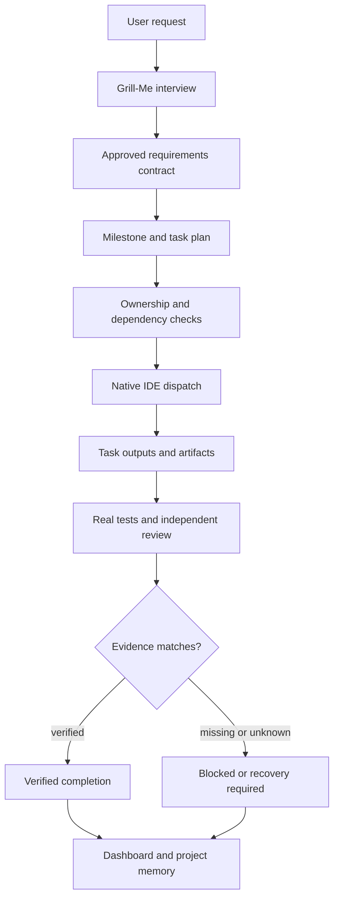

# Architecture

Auto-Orchestrator is a coordination and evidence layer around native IDE
agents. It does not host a model, proxy provider traffic or launch another IDE.
The native parent session remains the only entity that can spawn or cancel its
own subagents.



The diagram describes intent, not a guarantee that a vendor client will follow
the protocol. A dispatch is a recorded contract; the IDE performs the work.

## Layers

### 1. Instructions and entry points

- `.agents/skills/auto-orchestrator/` is the shared coordination skill.
- `.agents/skills/grill-me/` is the portable interview skill.
- Client-specific agents live in `.codex/agents/`, `.opencode/agents/`,
  `.cursor/agents/` and `.agents/agents/`.
- OpenCode adds `/teamwork` and `/grill-me` commands plus the `teamwork` skill.
- Antigravity keeps its native `/teamwork-preview` and `/grill-me`; the
  `ao-grill-me` skill only imports explicitly user-confirmed answers.

### 2. Planning and ownership

`tools/universal_teamwork.py` is the common CLI. It delegates to:

- **Supervisor** (`tools/supervisor.py`): durable task DAG, dependencies,
  attempts, leases, write scopes and retry state.
- **Teamwork engine** (`tools/teamwork*.py`): milestones, managed sessions,
  repair loops and operator status.
- **Planner/executor** (`tools/project_planner.py`, `tools/executor.py`):
  acceptance criteria and dispatch manifests.
- **IDE ownership** (`tools/ide_handoff.py`): one active writer, fence tokens,
  heartbeat TTL and explicit handoff snapshots.

The project-level writer lease prevents two runners from writing at once.
Ownership scopes are canonicalized before comparison so `src/api.py` and
`src/./api.py` cannot become concurrent writers.

### 3. Native dispatch

`tools/native_dispatch.py` stores one append-only JSON record per dispatch:

```text
.auto-orchestrator/native-dispatches/<run>/<dispatch>.json
```

Lifecycle:

```text
queued -> dispatch_requested -> dispatch_confirmed -> running
running <-> waiting_for_permission
running -> completed_claimed -> output_collected -> verification_pending -> verified
active  -> failed | cancelled | recovery_required
```

Key rules:

- `running` requires a native child reference supplied by the parent. A
  dispatch request is not a running child.
- `completed_claimed` is not completion. `collect` requires an artifact and
  records its SHA-256 and size.
- `verify` requires a matching `native-verification` record and advances only
  when that record is genuinely verified.
- Unknown lifecycle becomes `recovery_required`; it never becomes complete.
- At most three active dispatches, one active dispatch per task and disjoint
  write scopes.

### 4. Test evidence and verified completion

`native-verify` is the only command that issues a verification receipt. It:

1. runs the approved test command itself;
2. parses structured JUnit XML or pytest JSON;
3. refuses missing, skipped or inconsistent evidence;
4. binds the result to the commit, contract, plan, run and task;
5. rejects a dirty worktree at the merged-tree gate;
6. writes a dispatch artifact digest and an HMAC receipt.

`native-audit` records a review against the same HEAD. A `declared` review is
role-level evidence; it is not a cryptographic attestation that an independent
agent actually performed the review.

### 5. Continuity and dashboard

`brief` is a read-only summary for a new IDE session: active/previous IDE,
run/milestone/task, pending work, failed tests, open Grill-Me question,
verification state, unknown dispatches and explicit resume steps.

The dashboard (`tools/dashboard.py`) reads the same local files and SQLite
databases over loopback. It is a viewer, not a control plane: it cannot spawn,
stop or message an agent, claim a task, merge a worktree or replace the CLI.

## Data layout

```text
.auto-orchestrator/
  runs/                    native run JSONL
  supervisor.sqlite3       Supervisor task DAG and leases
  native-dispatches/       typed dispatch records
  verification/            receipts and test evidence
  ide/                     ownership, handoff and verification key
  project.json             portable project identity
  memory.sqlite3           durable project memory
```

`.auto-orchestrator/` is local runtime state. It is added to `.gitignore` by the
project installer when possible. Do not commit run logs, receipts, keys or
provider session data.

## Trust model

The layers separate three questions:

| Question | Evidence |
|---|---|
| Did the work run? | Native tool/session events, managed runner events or an explicit human report. |
| Did the tests pass? | A run-bound test result with a real exit code and parsed test cases. |
| Is completion verified? | A matching HMAC receipt, commit/contract/plan binding, an intact artifact and a clean merged tree. |

A successful run is not automatically verified. A verified test command is not
proof of full product correctness. An observed tool-span overlap is not measured
human time saved. Missing evidence is rendered as `unknown`, never as success.

## Integration boundaries

- **Codex:** native skill/agents and CLI; project or global hooks may observe
  subagent starts/stops when trusted by the client.
- **OpenCode V2:** in-process plugin, foreground subagent spans, commands and
  skills. Background child completion is not authoritative.
- **Cursor:** project-local hooks; start identity is available, stop identity is
  conditional. User-level hooks are intentionally not installed.
- **Antigravity:** session hooks and native commands; per-child stop is not
  attested by the documented hooks.

See the [capability matrix](CAPABILITY_MATRIX.md) for the exact per-platform
claims and [V8.0 dispatch](V80_NATIVE_DISPATCH.md) for the protocol details.
