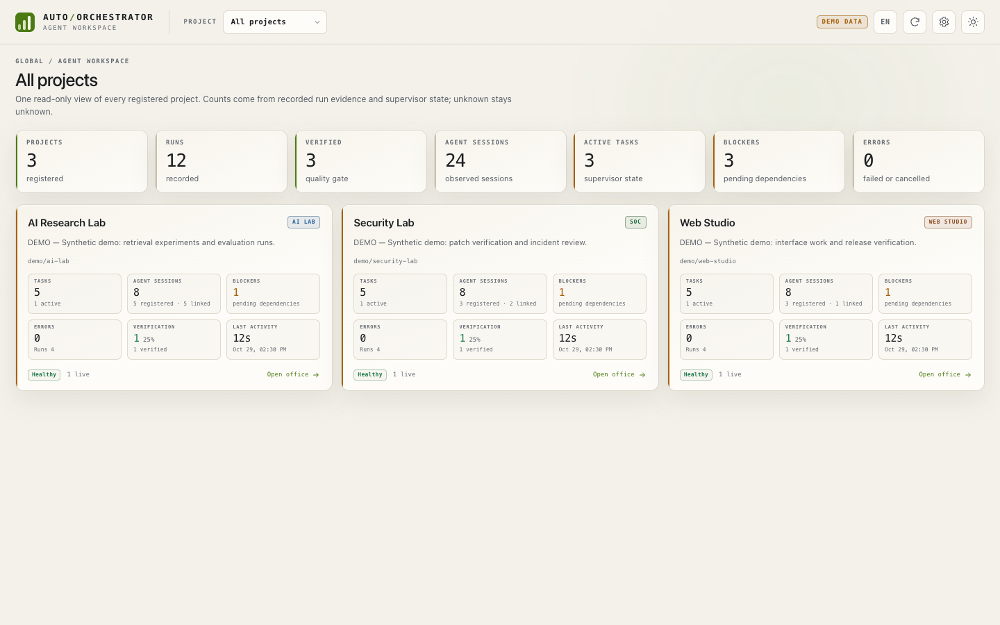
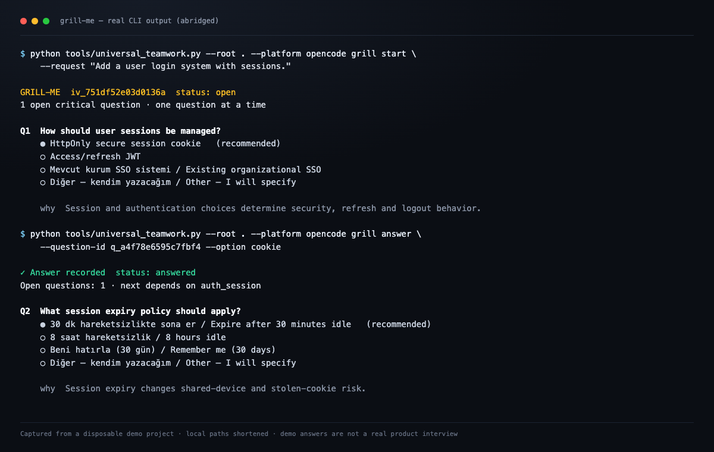
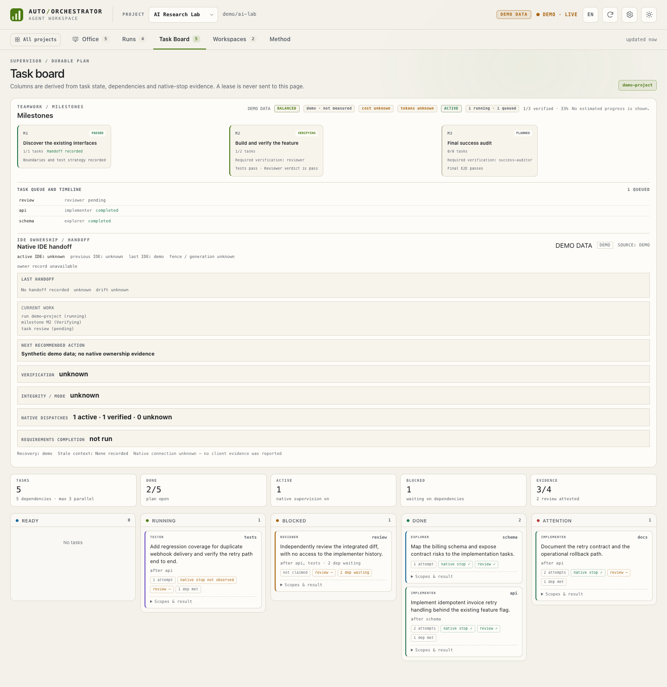
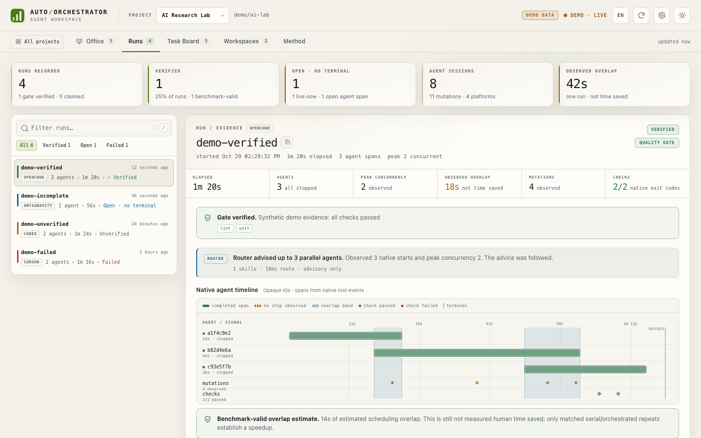

# Auto-Orchestrator — Türkçe kılavuz

**Native çok ajanlı takım çalışması, doğrulanmış tamamlama ve IDE sürekliliği.**

Auto-Orchestrator, mevcut IDE'nizin native subagent yeteneklerini koordine eden
yerel bir araç setidir. Kendi modelini barındırmaz, başka bir IDE başlatmaz ve
sizin adınıza LLM çağrısı yapmaz. Amaç; gereksinimleri netleştirmek, işi
milestone ve görevlere ayırmak, dosya sahipliğini korumak, gerçek test
kanıtlarını toplamak ve IDE değişse bile proje hafızasını sürdürmektir.

İngilizce ana sayfa: [README](../README.md)



> Görseldeki tüm veriler sentetiktir ve arayüzde **DEMO DATA** olarak
> etiketlenmiştir. Gerçek bir test sonucu veya performans ölçümü değildir.

## 1. Ne işe yarar?

- **Gereksinim netleştirme:** Riskli veya belirsiz işlerde tek seferde tek soru
  soran Grill-Me görüşmesi başlatır. Önerilen seçenek otomatik olarak
  onaylanmış sayılmaz.
- **Planlama:** İşi milestone'lara ve bağımlılıkları olan görevlere böler.
- **Sahiplik:** Aynı dosyaya iki ajanın aynı anda yazmasını engeller; yazma
  kapsamlarını kanonikleştirir.
- **Native dağıtım:** Ana IDE oturumunun başlattığı native child görevlerini
  kaydeder. Alt ajanı kendisi başlatmaz.
- **Doğrulama:** Testleri gerçekten çalıştırır, sonucu commit/plan/kontrat ve
  görevle ilişkilendirir; HMAC imzalı ve tek kullanımlık bir makbuz üretir.
- **Süreklilik:** Codex, OpenCode, Cursor ve Antigravity arasında proje
  hafızasını, kararları, açık soruları ve devir durumunu taşır.
- **Görünürlük:** Salt-okunur dashboard'da run, görev, doğrulama, sahiplik ve
  bilinmeyen durumları gösterir.

## 2. Hangi IDE'lerde çalışır?

| IDE | Giriş noktaları | Native Teamwork | Grill-Me | Devir (handoff) | Durum etiketi |
|---|---|---|---|---|---|
| **Codex** | skill + agent'lar + CLI | Plan ve kayıt destekli | Skill/CLI | Canlı doğrulanmış (V7.8/V7.9) | Child lifecycle `not-tested` |
| **OpenCode V2** | `/teamwork`, `/grill-me`, plugin, agent'lar | Native plan + managed çalışma | Komut + skill | Canlı doğrulanmış | Arka plan child tamamlanması desteklenmez |
| **Cursor** | agent'lar + skill + agent CLI | Protokol hazır | Skill | Simüle | Bu makinede `blocked-auth` |
| **Antigravity** | native `/teamwork-preview`, `/grill-me` | Köprü sınırlı | Native komut | Simüle | `contract-only` |

Ayrıntılı ve makine-okunur tablo: [Capability matrix](CAPABILITY_MATRIX.md).
Hiçbir IDE'yi başka bir IDE başlatmaz. Native child kimliği uydurulmaz.

## 3. OpenCode V2'ye kurulum

Python 3.11+ ve Git gerekir. Önce **dry-run** çalıştırın:

```bash
python3.11 tools/install.py \
  --target /proje/yolu \
  --platform opencode \
  --opencode-version v2 \
  --dry-run
```

Çıktıyı inceleyin. Sorun yoksa gerçek kurulumu yapın:

```bash
python3.11 tools/install.py \
  --target /proje/yolu \
  --platform opencode \
  --opencode-version v2
```

Kurulum şunları oluşturur:

- `.agents/skills/` altında ortak skill'ler;
- `.opencode/agents/`, `.opencode/commands/` ve `.opencode/skills/`;
- `.opencode/plugins/auto_orchestrator.js` (OpenCode V2 plugin'i);
- `tools/` altında CLI, dashboard ve V8.0 runtime modülleri;
- `AGENTS.md` içinde tek bir işaretli Auto-Orchestrator bölümü.

Mevcut provider anahtarlarınız, oturum geçmişiniz ve ilgisiz ayarlarınız
değiştirilmez. Var olan ve farklı içerik taşıyan dosyalar otomatik ezilmez.

Kurulumdan sonra OpenCode'u yeniden başlatın ve yeni bir oturum açın. Hedef
projede runtime'ı doğrulayın:

```bash
cd /proje/yolu
python3.11 tools/universal_teamwork.py --root . --platform opencode --help
python3.11 tools/universal_teamwork.py --root . --platform opencode brief
python3.11 tools/universal_teamwork.py --root . --platform opencode native-dispatch status --run-id smoke
python3.11 tools/dashboard.py --help
```

Bu komutlar kurulu Python runtime'ının çalıştığını kanıtlar; plugin'in IDE
tarafından yüklendiğini tek başına kanıtlamaz.

### Global kurulum (isteğe bağlı)

Aynı makinedeki birçok projede kullanmak isterseniz proje içi kurulum yerine
global kurulumu seçin. İkisini aynı çalışma alanında aynı anda yüklemek çift
hook ve çift telemetri üretebilir.

```bash
python3.11 tools/install_global.py \
  --platform opencode \
  --opencode-version v2 \
  --dry-run

python3.11 tools/install_global.py \
  --platform opencode \
  --opencode-version v2

python3.11 tools/doctor.py --platform opencode
```

`doctor` yalnızca dosya hazırlığını kontrol eder; canlı plugin yüklemesini,
model seçimini veya native subagent çalışmasını kanıtlamaz.

## 4. `/teamwork` nedir?

`/teamwork`, OpenCode sohbetinden bir Teamwork çalışması başlatır veya mevcut
çalışmayı yönetir. İstek metni shell komutuna gömülmez; doğrulanmış bir UTF-8
dosyasına yazılır ve `--request-file` ile iletilir.

```text
/teamwork --mode balanced Ödeme akışına idempotent yeniden deneme ekle
/teamwork status
/teamwork agents
/teamwork milestones
/teamwork cancel
```

- `--mode auto|solo|fast|balanced|rigorous` planlama derinliğini seçer.
- Normal modda OpenCode managed runner kullanılır.
- `--native` plan yazar; provider, runner veya PID başlatmaz. Planın açıkça
  onaylanması gerekir.
- Çalışma durumu, milestone, aktif/kuyruk oturumları, sahiplik ve doğrulama
  ayrı ayrı raporlanır.
- Testler geçmeden veya bağımsız inceleme tamamlanmadan `verified` denmez.

## 5. `/grill-me` nedir?

`/grill-me`, riskli veya belirsiz bir işe başlamadan önce gereksinimleri
netleştiren kalıcı bir görüşmedir. Aynı anda yalnızca bir soru sorar; sorunun
gerekçesini, önerilen seçeneği ve alternatifleri gösterir.

```text
/grill-me Kullanıcı giriş sistemi ekle
/grill-me status
/grill-me summary
/grill-me answer --question-id <id> --option <seçenek>
/grill-me approve
```

Önemli kurallar:

- Önerilen seçenek **seçilmiş sayılmaz**; açıkça cevap vermeniz gerekir.
- Kritik bir soru atlanırsa görüşme onaylanmaz ve uygulama başlamaz.
- Daha önceki bir cevabı değiştirmek yalnızca ona bağlı kararları geçersiz
  kılar; geçmiş korunur.
- Görüşme IDE değişse bile aynı `interview_id` ile devam eder.
- Onay, soru setinin özetine bağlı bir gereksinim kontratı üretir.



> Görsel, gerçek CLI çıktısından üretilmiştir; yerel yollar kısaltılmış ve
> cevaplar demo projesinde verilmiştir.

## 6. IDE değişiminde nasıl devam edilir?

Proje hafızası proje kökündeki `.auto-orchestrator/` altında tutulur. Yeni IDE
oturumunda önce salt-okunur özeti alın:

```bash
python3.11 tools/universal_teamwork.py --root . --platform opencode brief
```

`brief` şunları gösterir:

- aktif ve önceki IDE, sahiplik durumu ve fence;
- run, milestone ve görev;
- tamamlanan/bekleyen işler ve başarısız testler;
- açık Grill-Me sorusu ve onay durumu;
- doğrulama durumu ve bilinmeyen dispatch'ler;
- önerilen sonraki adım.

Devir açıkça yapılır; otomatik değildir:

```bash
# Mevcut IDE'de devri hazırla ve bırak
python3.11 tools/universal_teamwork.py --root . --platform codex ide prepare --target-platform opencode --confirm-idle user
python3.11 tools/universal_teamwork.py --root . --platform codex ide release --handoff <handoff_id> --confirm-idle user

# Yeni IDE'de devral
python3.11 tools/universal_teamwork.py --root . --platform opencode ide accept --handoff <handoff_id> --digest <sha256>
```

Kalp atışı eskiyse durum `unknown` olur; ölü sayılmaz. Bilinmeyen sahiplik
devri bloklar ve açık kurtarma kaydı gerektirir. Native iptal onayı
uydurulmaz.

## 7. Dashboard nasıl açılır?

Salt-okunur yerel dashboard:

```bash
python3.11 tools/dashboard.py --root . --open
```

Sentetik demo verisiyle (hiçbir dosya yazmaz):

```bash
python3.11 tools/dashboard.py --demo --open
```

Dashboard varsayılan olarak yalnızca loopback'e bağlanır. Ajan başlatmaz,
durdurmaz, görev sahiplenmez veya worktree birleştirmez. Sekmeler:

- **Office:** gerçek oturumlardan türetilen Virtual Agent Office ve Agent
  Inspector.
- **Runs:** run zaman çizelgesi, native span'ler, check'ler ve kanıt zinciri.
- **Task Board:** milestone'lar, görev durumu, sahiplik ve doğrulama.
- **Workspaces:** izole Git worktree manifestleri.
- **Method:** arayüzün neyi kanıtlayıp neyi kanıtlamadığı.





> Üç dashboard görseli de demo modundan alınmıştır; **DEMO DATA** etiketi
> görünür. Gerçek kullanıcı verisi, kaynak kodu veya gizli anahtar içermez.

## 8. Nasıl kaldırılır?

Önce dry-run:

```bash
# Proje içi kurulum
python3.11 tools/install.py --target /proje/yolu --uninstall --dry-run

# Global kurulum
python3.11 tools/install_global.py --uninstall --dry-run
```

Listeyi inceledikten sonra:

```bash
python3.11 tools/install.py --target /proje/yolu --uninstall
# veya
python3.11 tools/install_global.py --uninstall
```

Kaldırma yalnızca installer manifestinde kayıtlı ve içeriği değişmemiş
dosyaları siler. Kullanıcı tarafından düzenlenmiş dosyalar korunur. Proje
hafızası, run logları ve `.auto-orchestrator/` verisi kullanıcıya aittir;
istenirse ayrıca elle temizlenir.

## 9. Bilinen sınırlamalar

- **Native child lifecycle** her IDE'de canlı doğrulanmış değildir. Codex ve
  OpenCode için devir canlı denenmiştir; child tamamlanması hâlâ `not-tested`
  veya `foreground-only` olabilir.
- **Handoff ve dispatch protokolü** bir OS sandbox değildir. Aynı kullanıcı
  yetkilerine sahip bir süreç dosyaları değiştirebilir.
- **Cursor** bu makinede kimlik doğrulama nedeniyle `blocked-auth` durumundadır;
  bu bir kod hatası değildir.
- **Antigravity** adaptörü canlı doğrulanmış değildir; native komutlar
  otoritedir.
- **Token/maliyet tasarrufu** bağımsız bir benchmark ile kanıtlanmamıştır.
  Gözlenen span örtüşmesi, insan zamanı tasarrufu değildir.
- **Arka plan subagent** çağrısı, çocuk tamamlandığında değil, dağıtım kabul
  edildiğinde döner. Bu süre tam çalışma süresi sayılmaz.
- **OpenCode V1/V2** plugin API'leri farklıdır; ikisini aynı anda yüklemeyin.
- **Sohbet komutları model talimatıdır.** CLI motoru görüşme ve plan durumunu
  zorlar, ancak model komut metnini yok sayabilir. Bu turda `opencode run` ile
  yapılan bir `/grill-me` denemesinde model görüşmeyi atlayıp demo kod yazdı;
  alttaki CLI görüşmesi ayrıca doğrulandı. Gerçek TUI'de komutun ilk adımını
  kontrol edin.
- **Codex managed write** açık `--provider codex --codex-sandbox
  workspace-write` opt-in'i gerektirir; Cursor ve Antigravity managed execution
  uygulanmamıştır.

## 10. Daha fazla bilgi

- [Kurulum](GETTING_STARTED.md)
- [OpenCode V2 entegrasyonu](OPENCODE_V2.md)
- [Mimari](ARCHITECTURE.md)
- [Güvenlik ve doğrulama](SECURITY.md)
- [Sorun giderme](TROUBLESHOOTING.md)
- [Dashboard](DASHBOARD.md)
- [Capability matrix](CAPABILITY_MATRIX.md)
- [Sürüm geçmişi](HISTORY.md)
- [İngilizce README](../README.md)

Lisans: MIT. Katkı için GitHub üzerinden issue veya pull request açabilirsiniz.
