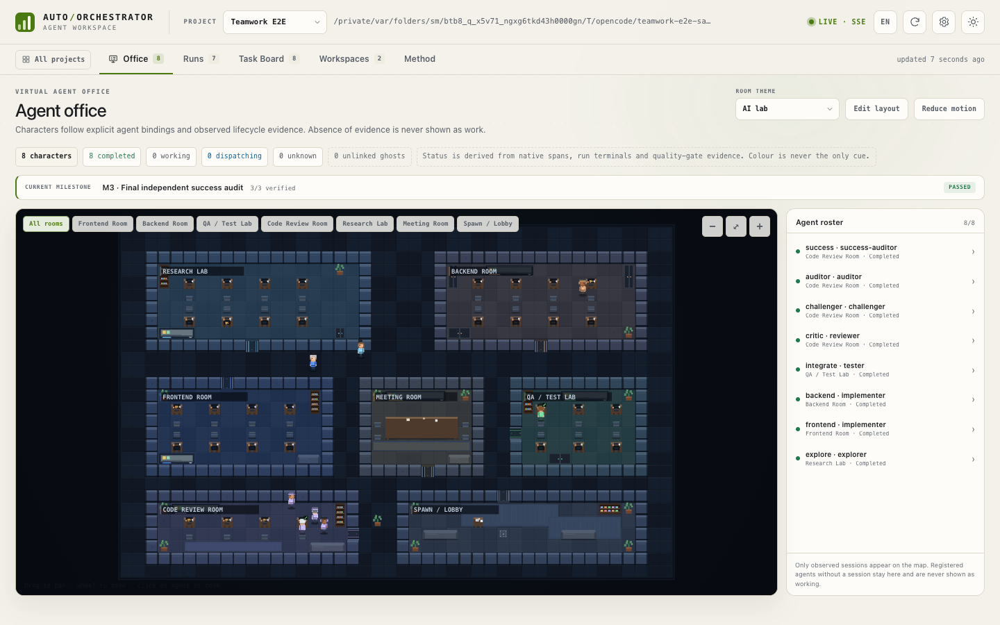

# Teamwork Engine, Managed Execution and Milestones (V7.3)

V7.3 turns the dashboard from an evidence viewer and dispatch-plan generator into
a **teamwork runtime** for real managed sessions. It keeps the V7.1/V7.2
read-only evidence semantics for native hooks and adds a separate
managed-execution path, milestone state, independent verification and repair.



## What is real and what is not

| Area | Status in this repository |
|---|---|
| OpenCode managed sessions | **Live local integration** through `opencode run --format json` (2.1.1), including event stream, tool metadata, usage/cost, resume and local process cancellation. |
| Codex App-server | **Contract-tested only.** The adapter implements initialize/thread/turn/interrupt against a fake JSON-RPC server. The `codex` binary is absent locally, so no live claim is made. |
| Antigravity / Cursor managed execution | **Not implemented.** Native hook observation remains as documented in the capability matrix. |
| Native hook observation | Preserved from V7.1/V7.2; managed completion is never written as native start/stop proof. |
| Virtual Office | Real managed sessions appear as separate managed characters with their role-derived rooms; native and unmanaged sessions keep their existing semantics. |
| E2E sample | **Real OpenCode sessions** built, integrated, tested and reviewed; see below. |
| Failure recovery | **Real controlled fault run** on an isolated copy; a tester failure reopened the frontend implementer and the integrated suites passed after repair. |

The detailed native/managed matrix is in [CAPABILITY_MATRIX.md](CAPABILITY_MATRIX.md).
The machine-readable values come from `python tools/capabilities.py show --json`
(`managed_execution` section).

## Architecture

```text
single user request
        ↓
Teamwork planner (deterministic patterns)
        ↓
Supervisor SQLite  ──  milestones, task DAG, leases, retries
        ↓
Teamwork runner
        ├─ worktree per implementer
        ├─ managed OpenCode session
        ├─ sanitized event stream + usage
        ├─ scope check + independent commands
        └─ integrate completed branches
        ↓
tester → critic → challenger → auditor → success auditor
        ↓
repair loop when a verifier fails (bounded)
        ↓
milestone handoff → next milestone
```

### Roles

| Role | Responsibility | Room |
|---|---|---|
| Supervisor/Sentinel | user-facing coordination and final summary | orchestration |
| Explorer | read-only discovery and risk map | Research Lab |
| Implementer | code + focused unit tests in a worktree | Backend / Frontend |
| Tester | integrated unit/E2E execution and reproduction | QA / Test Lab |
| Critic/Reviewer | independent logic, race and regression review | Code Review Room |
| Challenger | adversarial/edge-case tests | Code Review Room |
| Auditor | command/exit/diff/acceptance audit | Code Review Room |
| Success Auditor | final independent cross-stack E2E | Code Review Room |

The deterministic planner uses more roles only for larger requests. Small
research or single-layer work uses fewer milestones; the default parallel limit
is three and remains configurable.

### Patterns

`iterative_coding`, `distributed_coding`, `review_and_repair`, `research`.
The planner is template-based and makes no LLM call; repository-specific paths
and commands are explicitly marked for confirmation. Runtime validation still
rejects dependency cycles, scope conflicts and unordered overlapping writes.

## Milestone state machine

```text
planned → ready → running → verifying → passed
                    ↑          │
                    └ repairing┘ (bounded reopen)
                    └ failed / blocked / cancelled
```

- A milestone becomes `ready` only after every prerequisite milestone is
  `passed`.
- `passed` requires every mapped task to be `completed` **and** each role in
  `verification_policy.require_roles` to have a completed task with
  `result.verdict == "pass"`.
- `verified_progress = passed milestones / all milestones`. `estimated_progress`
  is always `null`; the UI never presents an estimate as verified completion.
- `reopen()` resets a completed or failed task for a bounded repair, clears its
  lease/result and increments the repair counter. It never sends a native
  cancel or claims one.
- Restart rehydrates milestones, tasks, managed sessions and handoff metadata
  from the existing Supervisor SQLite database.

## Managed execution

OpenCode is the first-class managed provider:

- `opencode run --format json --standalone ...` starts a real session;
- JSONL events provide text, tool name/status/exit, usage/cost and session id;
- prompts, environment values and full command/content fields are not persisted;
- completion requires process exit 0 without an error event;
- `--session <id>` resumes a session;
- cancellation sends a local process-group signal and returns
  `native_cancel_ack: false`, `local_signal_only: true`.

The Codex adapter implements the documented app-server JSON-RPC surface but has
only fake-server coverage. Antigravity/Cursor return unavailable rather than
inventing a managed session.

## Repair loop

When a verifier fails, the runner:

1. reads the failed command evidence;
2. reopens the relevant implementer (frontend/backend heuristic or an explicit
   `repair_target`) and the failed verification task;
3. dispatches the implementer again with the failure reason and evidence;
4. commits and re-integrates the worktree;
5. reruns the verifier and downstream roles;
6. stops at the milestone `max_repair` bound and reports `failed`/`blocked`
   rather than looping forever.

## Real E2E: `teamwork-e2e-sample`

The sample is a small task manager with a Python stdlib API, static frontend,
unit tests and a Playwright browser E2E. The scaffold contains only a contract
and a Git repository; all product code and tests were written by managed
OpenCode sessions.

Result: **passed**, `verified_progress: 1.0`, all three handoffs recorded.

| Item | Measured |
|---|---|
| Milestones | M1 discovery, M2 build+verify, M3 success audit — all passed |
| Managed sessions | 10 attempts (including the environment repair) |
| Backend tests | 60 total after challenger edge cases; all pass |
| Browser E2E | 7 checkpoints pass against a real backend |
| Independent roles | reviewer, challenger, auditor and success-auditor verdicts pass |
| Wall span | ~26 minutes (00:13–00:39 local) |
| Provider cost | ~$0.140 reported by the OpenCode stream |
| Changed files | 9 declared files; contract/readme untouched |
| Integration | real worktree branches merged; final tree clean |

The first integration attempt exposed a missing Playwright Chromium build, not
an application defect. The environment was repaired and both suites passed;
this is explicitly counted as an environment repair, not a product-code repair.

### Failure recovery

A second isolated copy was seeded with the working sample, then the frontend
`config.js` API base was deliberately changed to an unreachable loopback port
and committed as a controlled fault.

1. `integrate` tester failed both suites with the injected config defect.
2. The supervisor kept the milestone from passing.
3. The repair heuristic reopened the frontend implementer and the failed tester.
4. The frontend agent restored `window.AO_API_BASE = ""`.
5. Integration and the tester reran; backend and browser E2E passed.
6. Critic/challenger/auditor and success-auditor continued through the same
   milestone state machine.

Measured failure-recovery run: 10 managed sessions, 2 repair iterations (frontend
and the failed tester), ~9.7 minutes, ~$0.103 reported cost, 86 backend tests and
8 browser checkpoints passed after repair. The final success auditor recorded a
clean tree and confirmed the injected fault was no longer present.

The sanitized evidence bundle is
[`v73-e2e-evidence.json`](assets/v73-e2e-evidence.json); it contains session
hashes, command/exit evidence and handoff names, never raw session IDs.
The repository does not pretend that this fault was a production incident.

## Dashboard and Virtual Office

- Task Board includes a **Milestones** panel with status, task counts, required
  verification roles, handoff markers and verified-only progress.
- Clicking a milestone filters task cards to that milestone; a clear control
  restores the run.
- The office header shows the current milestone and verified progress.
- Real managed sessions are exposed by the office API separately from native
  unlinked sessions. They spawn characters in their role-derived rooms and open
  a **Managed session** inspector with task, provider, model, status, tool count,
  cost, session hash and the explicit no-native-stop limitation.
- Raw managed session ids and event paths are not exposed by the dashboard; the
  UI receives a short hash.
- Old native/unlinked sessions retain the V7.1 evidence semantics.

## Commands

```bash
# Generate a deterministic milestone plan
python tools/teamwork_cli.py plan \
  --request "Build a task manager with backend, frontend and tests" \
  --run-id teamwork-demo --model opencode-go/deepseek-v4.1-flash \
  --out .auto-orchestrator/plans/teamwork-demo.json

# Initialize and inspect
python tools/teamwork_cli.py --root /path/to/project init \
  --plan .auto-orchestrator/plans/teamwork-demo.json
python tools/teamwork_cli.py --root /path/to/project status --run-id teamwork-demo

# Run through managed OpenCode
python tools/teamwork_cli.py --root /path/to/project run \
  --plan .auto-orchestrator/plans/teamwork-demo.json \
  --model opencode-go/deepseek-v4.1-flash

# Reproduce the sample E2E in a disposable directory
python tools/v73_e2e.py --root /tmp/teamwork-e2e-sample \
  --run-id teamwork-e2e --model opencode-go/deepseek-v4.1-flash

# Serial baseline (one agent, same contract)
python tools/v73_serial_baseline.py --json-out /tmp/serial.json
```

## Measured serial vs orchestrated comparison

A real single-agent baseline used the same scaffold, model and acceptance
suites. It completed in **180.8 s**, cost **$0.022**, and passed the backend and
browser suites. The orchestrated run took **1566.1 s**, cost **$0.140**, used
10 managed sessions and passed the same two suites plus independent review.

The measured wall-time difference is **-1385.3 s** (the serial run was faster),
so this repository does **not** claim a time saving. The comparison is stored in
[`v73-benchmark.json`](assets/v73-benchmark.json) with `observed_overlap`,
`measured_wall_time` and `verified_improvement` separated. The orchestration
spent its time on independent tester, critic, challenger, auditor and success
auditor sessions; the serial run spent less time but did not reproduce the same
independent verification structure. This is a quality/overhead trade-off, not a
human-time-saving claim.

## Limits

- No real Codex, Antigravity or Cursor managed session was executed locally.
- OpenCode cancellation is a local process signal; there is no native cancel
  acknowledgement or background-stop proof.
- No live terminal/PTY stream is attached.
- Browser E2E requires a Playwright browser or the documented
  `AO_CHROMIUM_EXECUTABLE`/system Chrome.
- Native IDE hooks, managed sessions and simulated contract tests are kept as
  separate evidence categories. A passing managed E2E is not a native-hook
  smoke test.
